# SVG export: a label with a control character, or with `<` or `&` before a combining mark, gives malformed SVG

**The source** (Mermaid, ASCII only):

```mermaid
flowchart LR
  A["a <&#769; b"] --> B[ok]
```



**Expected** — an SVG document that parses as XML, with the label's `<` written as `&lt;`. `SVGBridgeTests` asserts
the same: "bridged SVG must be XML-parseable".

**Actual** — `MermaidRenderer.svg(source:theme:)` writes the `<` raw. Line 6 of the document, through `cat -v`:

```
<text x="40.15" y="28.066" font-size="12" font-weight="500" text-anchor="middle" dominant-baseline="central" fill="rgba(29, 29, 31, 1)">a <M-LM-^A b</text>
```

`XMLParser(data:).parse()` returns `false`: code 68, "StartTag: invalid element name", at line 6.

`SVGRenderer.escape(_:)` switches on `Character`. Since #90 the label's `&#769;` decodes to U+0301 COMBINING ACUTE
ACCENT, which joins the `<` before it into one `Character`. That `Character` is not `"<"`, so it falls to `default`
and is copied as it is. `&` before a combining mark goes the same way.

The other route is a character XML 1.0 forbids outright: a C0 control other than tab, LF and CR, or U+FFFE or
U+FFFF. No escape can write these; `&#1;` is malformed too. `MermaidParser.referenced(_:)` already refuses them as
references, because "SVG can't hold them". But typed or pasted straight into the source, they reach `<text>` raw.

| source, as a Swift string passed to `MermaidRenderer.svg(source:theme:)` | what reaches `<text>` (`cat -v`) | `XMLParser`'s first error |
|---|---|---|
| `"flowchart LR\n  A[\"a <&#769; b\"] --> B[ok]"` | `a <M-LM-^A b` | 68, StartTag: invalid element name |
| `"flowchart LR\n  A[\"a &amp;&#769; b\"] --> B[ok]"` | `a &M-LM-^A b` | 68, xmlParseEntityRef: no name |
| `"flowchart LR\n  A[\"a \u{1B}[1mb\u{1B}[0m\"] --> B[ok]"` (ESC, as pasted from a terminal) | `a ^[[1mb^[[0m` | 9, PCDATA invalid Char value 27 |
| `"sequenceDiagram\n  Alice->>Bob: hi\u{1}there"` | `hi^Athere` | 9, PCDATA invalid Char value 1 |
| `"flowchart LR\n  A[\"a < b & c\"] --> B[ok]"` (control) | `a &lt; b &amp; c` | well-formed |

**A possible fix** — walk scalars instead of `Character`s, and write U+FFFD for what XML can't hold:

```diff
--- a/Sources/MermaidLayout/SVGRenderer.swift
+++ b/Sources/MermaidLayout/SVGRenderer.swift
@@ -154,18 +154,24 @@ public enum SVGRenderer {
         return s
     }
 
-    /// Escapes the five XML predefined entities so labels can't break the doc.
+    /// Escapes the five XML predefined entities so labels can't break the doc,
+    /// and writes U+FFFD for a character XML 1.0 can't hold at all, even as a
+    /// reference: a C0 control other than tab, LF and CR, or U+FFFE / U+FFFF.
+    /// Walks scalars, not Characters: "<" plus a combining mark is one
+    /// Character, and it isn't "<".
     static func escape(_ text: String) -> String {
         var out = ""
-        out.reserveCapacity(text.count)
-        for ch in text {
-            switch ch {
+        out.reserveCapacity(text.utf8.count)
+        for scalar in text.unicodeScalars {
+            switch scalar {
             case "&": out += "&amp;"
             case "<": out += "&lt;"
             case ">": out += "&gt;"
             case "\"": out += "&quot;"
             case "'": out += "&#39;"
-            default: out.append(ch)
+            case "\t", "\n", "\r": out.unicodeScalars.append(scalar)
+            case "\u{0}"..."\u{1F}", "\u{FFFE}", "\u{FFFF}": out += "\u{FFFD}"
+            default: out.unicodeScalars.append(scalar)
             }
         }
         return out
```

Output changes only where a label holds one of those characters, or an escaped character with a combining mark
after it. Otherwise the loop writes the same replacements and copies the rest. The control above comes out byte for
byte the same. I have an XCTest file for `MermaidRenderTests`, `SVGLabelWellFormedTests.swift`, with the five sources
above and a check of every forbidden code point straight through `SVGRenderer.svg`. On `main`, 5 of its 6 tests fail
(34 assertions) and the control passes. With the patch all 6 pass, and so does the rest of `swift test`: 508 + 16
tests, 2 skipped. Happy to open a PR with both.

**Platform & output**: macOS 27.2, Xcode 27.2 (Swift 6.4.2), arm64. MermaidKit `main` at `046d49e` (v2.10.1).
Rendered with `MermaidRenderer.svg(source:theme:)` and `DiagramTheme(prefersDark: false)`. `SVGRenderer.swift` has
not changed since `04054ef`.

---

Found while checking whether XML written by Swift packages parses.
